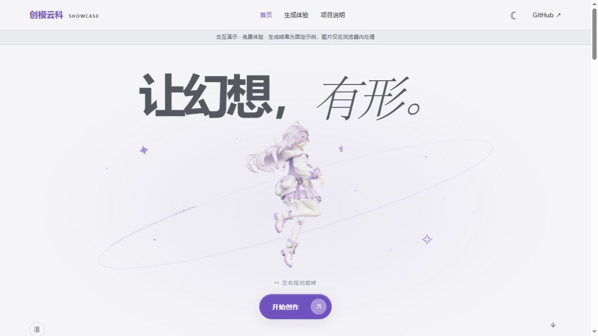
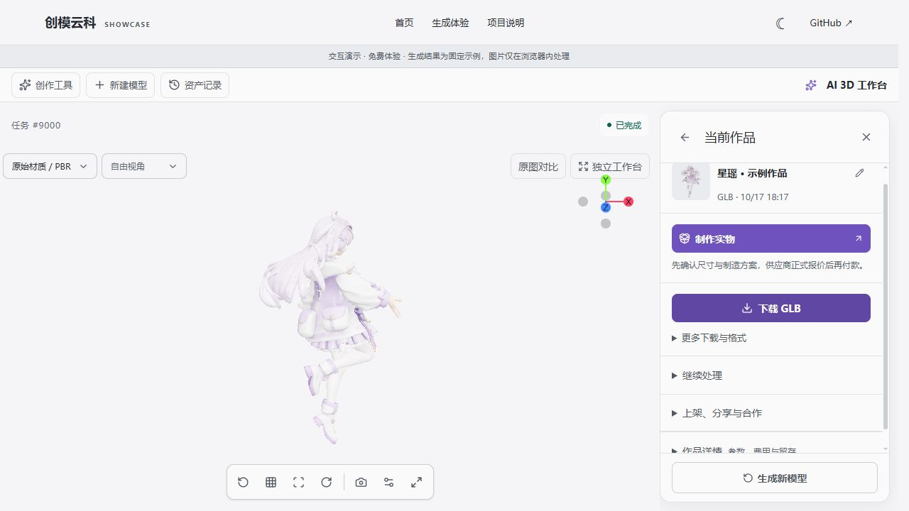

# 创模云科 · 交互演示

**让幻想，有形。**

从平面灵感到 3D 作品，体验 AI 生成、设计师精修与实物制造的产品构想。

**[打开在线演示](https://dulaoye37.github.io/chuangmo-yunke-showcase/)** · [直接查看 3D 工作台](https://dulaoye37.github.io/chuangmo-yunke-showcase/#/generate/9000) · [演示说明](https://dulaoye37.github.io/chuangmo-yunke-showcase/#/about)

## 可以体验什么

- **3D 交互首页**：拖动角色旋转、切换创作流程、浏览模型的不同视角。
- **生成工作台**：文字或图片输入、参数选择、模拟进度、历史记录与任务取消。
- **模型查看**：旋转、缩放、材质与视角切换、线框、网格及 GLB 示例下载。
- **界面体验**：深浅主题切换，适配桌面与手机屏幕。

## 一分钟体验

1. 打开在线演示，拖动首页角色查看不同角度。
2. 进入「生成体验」，选择「文字生成」，填写一段描述。
3. 点击「开始生成」，等待约 12 秒，查看示例模型。
4. 也可以从「资产记录」直接打开内置的「星瑶 · 示例作品」。

## 演示范围

这是独立的纯前端展示版本。生成流程为浏览器内模拟，始终返回固定星瑶模型，与输入描述或图片无关，不代表真实 AI 生成结果。

- 无需注册，不产生真实费用；界面中的余额为虚拟数据。
- 图片只在当前浏览器内存中处理，不发送到后端或 AI 服务；刷新页面后任务和图片清空。
- 登录、支付、真实生成、设计师接单、制造交易等服务没有接入；相关入口进入项目说明。
- 站点文件通过 GitHub Pages 提供；托管平台可能按其自身政策处理访问日志。
- 此仓库仅包含展示用构建产物与素材，不包含完整业务源码、管理后台、数据库或运行配置。

## 技术

Vue 3 · TypeScript · Vite · Pinia · Vue Router · Three.js · Tailwind CSS

GitHub Pages 从 `main` 分支根目录发布，使用 Hash 路由，支持直接分享模型查看链接。

## 素材与依赖

星瑶角色及图片来自本项目已有展示素材。展示不代表额外授予品牌、角色或素材的商用许可。第三方组件遵循各自许可证，见 [第三方许可](THIRD_PARTY_NOTICES.txt)。
